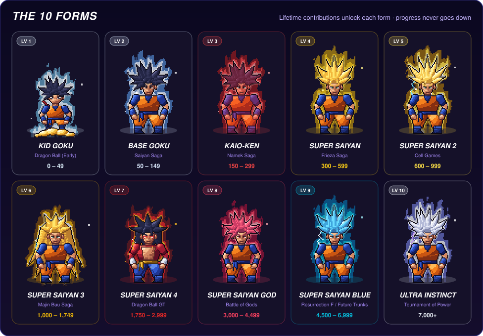

<div align="center">

# git-saiyan

**Turn your GitHub contributions into a Dragon Ball pixel-art card.**

Lifetime contributions drive a 10-form transformation ladder. Your streak
drives the ki aura. Each year is a new hunt for the 7 Dragon Balls.

[](https://github.com/marketplace/actions/git-saiyan)


Animated **SVG** (SMIL) + **GIF** · zero Docker · zero native modules



</div>

## Progression tables

<p align="center">
  
</p>

Forms unlock at lifetime contribution totals:

| Level | Form | Saga | Contributions |
| :---: | :--- | :--- | ---: |
| 1 | Kid Goku | Dragon Ball (Early) | 0 – 49 |
| 2 | Base Goku | Saiyan Saga | 50 – 149 |
| 3 | Kaio-ken | Namek Saga | 150 – 299 |
| 4 | Super Saiyan | Frieza Saga | 300 – 599 |
| 5 | Super Saiyan 2 | Cell Games | 600 – 999 |
| 6 | Super Saiyan 3 | Majin Buu Saga | 1,000 – 1,749 |
| 7 | Super Saiyan 4 | Dragon Ball GT | 1,750 – 2,999 |
| 8 | Super Saiyan God | Battle of Gods | 3,000 – 4,499 |
| 9 | Super Saiyan Blue | Resurrection F / Future Trunks | 4,500 – 6,999 |
| 10 | Ultra Instinct | Tournament of Power | 7,000+ |

Each form has 3 power-up stages: stage 2 at one-third and stage 3 at two-thirds of the way to the next form. Ultra Instinct is always at stage 3.

Dragon Balls are a yearly hunt over the trailing 365 days:

| Ball | 1★ | 2★ | 3★ | 4★ | 5★ | 6★ | 7★ |
| :--- | ---: | ---: | ---: | ---: | ---: | ---: | ---: |
| Contributions in the last 365 days | 10 | 25 | 50 | 100 | 200 | 350 | 500 |

Aura tiers by current streak:

| Daily streak | Weekly streak | Aura |
| :--- | :--- | :--- |
| 0 – 2 days | 0 – 1 weeks | Calm idle |
| 3 – 6 days | 2 – 3 weeks | Flaring Ki |
| 7 – 13 days | 4 – 7 weeks | Super flare + lightning |
| 14+ days | 8+ weeks | Hyper storm |

Thresholds were checked against 243 real profile READMEs that run a contribution widget: the median user sits at Super Saiyan 2, about 7% reach Ultra Instinct, and with power-up stages the median wait for a visible change is about 3 months.

## Features

- **Lifetime progression.** Forms are based on career contribution totals, not a rolling 12-month window. A persisted state file makes progression monotonic: old commits aging out never demote you.
- **10 transformation levels.** Kid Goku through Ultra Instinct as shaded 4-tone pixel art, with a distinct hair sculpt, palette and eyes per form (SSJ3 mane, SSJ4 fur and tail, God slim build, Kid Goku on the cloud).
- **Ki-charge animation.** 8 frames of hair flutter, sash sway and breathing inside a flame aura that grows with your streak, with rising ki particles and lightning on spark forms. Kid Goku rides the cloud with his tail and power pole.
- **Power-up stages.** Each form has 3 stages (at one-third and two-thirds of the way to the next form). Each stage grows the aura and adds a hair and body glow, so the card changes every few months instead of once a year.
- **Next-form countdown.** The card shows how many contributions are left and an estimate such as "super saiyan 3 in ~5 months", from your trailing-year pace.
- **Yearly Dragon Ball hunt.** The 7 balls come from your last 365 days (10 / 25 / 50 / 100 / 200 / 350 / 500). Collect all 7 to summon Shenron. Balls can be lost after a quiet year; forms never go down.
- **Streak-driven aura, daily or weekly.** Daily (default): committing today or yesterday keeps the streak alive. Weekly: any contribution in a Monday-Sunday week keeps it alive, for people who don't code every day.
- **Two output formats.** An animated SVG (real text, vector Dragon Balls, embedded pixel frames) and an 8-frame GIF with the same art and HUD for platforms that don't render SVG.
- **Transparent scoring.** Power level is `commits × 10 + PRs × 30 + reviews × 20 + best streak × 50`, computed from disjoint lifetime inputs.

## Quick start

Everything happens in the browser and takes about 5 minutes. The full step-by-step walkthrough with troubleshooting is in **[docs/setup.md](./docs/setup.md)**.

1. **Profile repository.** Open (or [create](https://github.com/new)) the public repository named exactly like your username: `USERNAME/USERNAME`.
2. **Workflow.** In that repository, create `.github/workflows/saiyan.yml` (**Add file → Create new file**) with this content:

   ```yaml
   name: Update Git Saiyan

   on:
     schedule:
       - cron: '0 0 * * *'
     workflow_dispatch:

   permissions:
     contents: write

   concurrency:
     group: git-saiyan
     cancel-in-progress: true

   jobs:
     power-up:
       runs-on: ubuntu-latest
       steps:
         - name: Checkout profile repository
           uses: actions/checkout@v7

         - name: Restore progression state
           run: |
             git fetch origin output --depth=1 || true
             git show origin/output:.saiyan-state.json > .saiyan-state.json 2>/dev/null || true

         - name: Run git-saiyan
           uses: jaeef/git-saiyan@v1
           with:
             github_token: ${{ secrets.GITHUB_TOKEN }}
             outputs: |
               dist/saiyan.svg
               dist/saiyan.gif
             state_file: .saiyan-state.json
             # streak_mode: weekly   # optional: count weeks instead of days

         - name: Publish generated card to the output branch
           run: |
             git config user.name "github-actions[bot]"
             git config user.email "41898282+github-actions[bot]@users.noreply.github.com"
             git add -f dist/saiyan.svg dist/saiyan.gif .saiyan-state.json
             if git rev-parse --verify --quiet origin/output >/dev/null && git diff --staged --quiet origin/output -- dist/saiyan.svg dist/saiyan.gif .saiyan-state.json; then
               echo "No card changes today."
             else
               git commit -m "chore: power up Goku [skip ci]"
               git push origin HEAD:output --force
             fi
   ```

3. **First run.** Go to **Actions → Update Git Saiyan → Run workflow**. After about 15 seconds the run is green and an `output` branch holds your card. It then updates every night.
4. **Show it.** Add this to your profile `README.md`, with your username in both places:

   ```markdown
   <p align="center">
     
   </p>
   ```

> **Card shows a lower form than you expect?** Your private contributions aren't counted yet. Turn on **Settings → Public profile → Include private contributions on my profile** and run the workflow again. See [private contributions](./docs/setup.md#5-count-private-contributions) for the token alternative.

Prefer the terminal? After `npm ci && npm run build` in this repository, `node dist/cli.js init` writes the workflow into the current profile repository.

## Action inputs

| Input | Required | Default | Description |
| :-- | :---: | :-- | :-- |
| `github_token` | no | `${{ github.token }}` | Token for contribution queries. Use a PAT for private contributions. |
| `github_user_name` | no | Repository owner | GitHub user to render. Must be a user, not an organization. |
| `outputs` | no | `dist/saiyan.svg`, `dist/saiyan.gif` | Output paths, newline- or comma-separated. `.svg` and `.gif` are supported. |
| `state_file` | no | `.saiyan-state.json` | Persisted progression. Commit it with the card. |
| `streak_mode` | no | `daily` | `daily` (days in a row) or `weekly` (weeks with at least one contribution). |

## State file

`.saiyan-state.json` stores `peakContributions`, `unlockedBalls`, `bestStreak`, `bestWeekStreak`, and `powerLevel`. Forms, best streaks and power level take the maximum of live stats and the stored values, so they can only advance. Dragon Balls follow the trailing year by design. The file is written atomically and its timestamp only changes when a value changes. The workflow compares the new card with the `output` branch and skips the push when nothing changed.

Keep the state file single-writer. The generated workflow already uses a `concurrency` group.

## CLI

Run from this repository after `npm ci && npm run build` (or use `npm start --`):

```bash
# Live card (requires a token)
GITHUB_TOKEN=ghp_... node dist/cli.js --user your-name

# Offline demo
node dist/cli.js --mock

# Preview a specific form
node dist/cli.js --form mui
node dist/cli.js --form ssj3

# Simulate a career and persist progression
node dist/cli.js --commits 7200 --streak 21 --state .saiyan-state.json

# Install the profile workflow
node dist/cli.js init
```

| Flag | Description | Default |
| :-- | :-- | :-- |
| `-u, --user <username>` | GitHub username to inspect | `octocat` |
| `-t, --token <token>` | GitHub token (or `GITHUB_TOKEN` env) | `$GITHUB_TOKEN` |
| `-o, --output <paths...>` | Output destinations (`.svg` / `.gif`) | `dist/saiyan.svg dist/saiyan.gif` |
| `-m, --mock` | Generate demo stats offline | `false` |
| `-f, --form <formId>` | Preview one form (implies demo data) | — |
| `-c, --commits <count>` | Override lifetime contributions | — |
| `-s, --streak <days>` | Override current streak | — |
| `--state <path>` | Persist progression | disabled |
| `--streak-mode <mode>` | `daily` or `weekly` streaks for the aura | `daily` |

`--form`, `--commits`, and `--streak` always use demo data. Live rendering requires a token and fails loudly on API errors instead of falling back to mock output.

## How it works

1. **Fetch.** One GraphQL query reads the trailing-year contribution calendar; a second aliased query sums per-year totals for lifetime counts, commits, PRs, and reviews.
2. **Progress.** Live stats are merged with the state file under max operations. `src/engine/card.ts` then derives everything the card shows (form, power-up stage, countdown, yearly balls, daily or weekly streak), so the SVG and GIF never disagree.
3. **Draw.** `src/art/` builds the character from shaded primitives (lit from the top-left, quantized onto hand-picked 4-tone ramps, 1px outlines), then adds the flame aura, particles and lightning. It produces 8 frames on a 128×120 canvas, shown at 2×.
4. **Render.** The SVG embeds those frames as small PNGs flipped with discrete SMIL steps, animates the Dragon Ball orbit with SMIL, and shows a still frame under `prefers-reduced-motion`. The GIF draws the same frames with a 3×5 bitmap font HUD and one shared 256-color palette.

```
src/
├── api/         GraphQL client and shared types
├── art/         character rig, rasterizer, aura effects, PNG encoder
├── assets/      Dragon Ball sprite and star layouts
├── engine/      activity, forms, dragon balls, aura rules, card model
├── renderer/    svg, gif, bitmap font
├── types/       ambient module declarations
├── action.ts    Action entry point
├── cli.ts       CLI entry point
├── index.ts     render pipeline and Action logic
├── init.ts      workflow installer
└── state.ts     progression persistence
```

## Development

```bash
npm ci
npm run verify        # typecheck + tests + build
npm test              # tests only
npm start -- --mock   # demo card into dist/saiyan.svg + .gif (gitignored)
npm run preview:art -- sheet.png       # contact sheet of every form (args: forms streak frames scale)
npm run gallery                         # preview/index.html: every form, full and calm aura
npm run scenarios                       # preview/scenarios.html: streak scenarios, daily vs weekly
npm run designs                         # preview/designs.html: card design study
npm run forms-sheet                     # docs/forms.svg: the all-forms sheet in this README
```

CI runs typecheck, the test suite, the build, and verifies that committed `dist/` matches `src/`. `dist/` is committed because the Action needs `dist/action.js` at the tagged ref.

## License and trademark notice

The code is licensed under the [MIT License](./LICENSE).

The character art is Dragon Ball fan art. Dragon Ball is a trademark of Bird Studio / Shueisha / Toei Animation. This is an unofficial fan project and is not affiliated with or endorsed by the rights holders. The MIT license covers the code, not the fan character art. Do not use it commercially or list it on a marketplace. Rights holders may request its removal.

Inspired by [Platane/snk](https://github.com/Platane/snk) and [yalongwastaken/git-koi](https://github.com/yalongwastaken/git-koi).
